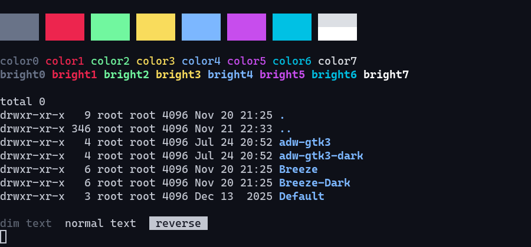

# Sweet-Alacritty

Sweet theme for [alacritty](https://github.com/alacritty/alacritty) terminal emulator

The colors are the original Sweet konsole scheme's: `#161925` background, `#c3c7d1` text, and the Sweet palette for the 16 terminal colors

## Requirements

There's none, it's a color scheme

**Optional**

- `CaskaydiaCove Nerd Font Mono`, Sweet's default monospace font

## Installation

Copy theme file to your desired location, e.g. `~/.config/alacritty/themes/Sweet.toml`

Then, import your theme in config file, e.g. `~/.config/alacritty/alacritty.toml`:

```toml
[general]
import = ["~/.config/alacritty/themes/Sweet.toml"]
```

See [example](example/alacritty.toml) for a full config, with the translucent window of the original konsole scheme (`opacity = 0.65`)

## Showcase


