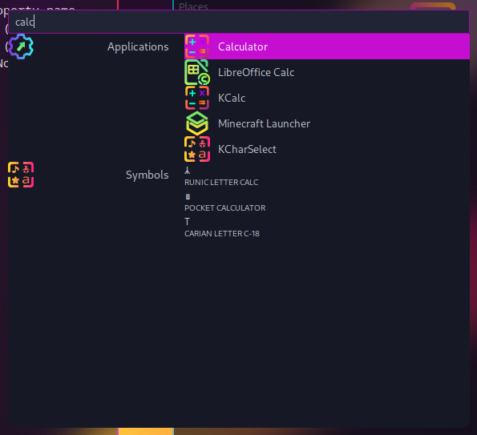

# Sweet-Anyrun

Instruction on how to use `Sweet` theme with [anyrun](https://github.com/anyrun-org/anyrun)

## Requirements

- Sweet GTK theme: [Sweet-gtk](https://github.com/Gigas002/Sweet-gtk) ([PKGBUILD](../PKGBUILDs/sweet-gtk-theme-git))
- Sweet folder icons: [Sweet-folders](https://github.com/Gigas002/Sweet-folders) ([PKGBUILD](../PKGBUILDs/sweet-folders-git))

## Installation

`anyrun` uses your GTK theme by default, so additional tweaking to add `Sweet`ish look to it is not needed, but you can always additionally configure your `~/.config/anyrun/config.ron` and `~/.config/anyrun/style.css` for a better looks

## Showcase

