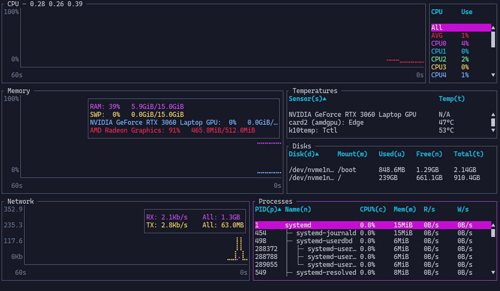

# Sweet-bottom

Sweet colors for [bottom](https://github.com/ClementTsang/bottom) (`btm`) system monitor

## Requirements

- bottom 0.10 or newer (the `[styles]` config section)

## Installation

bottom has no separate theme files: copy the contents of `Sweet.toml` into `~/.config/bottom/bottom.toml`. See [example](example/bottom.toml)

The background is left to the terminal, so it shows your terminal's Sweet background and transparency

## Showcase

