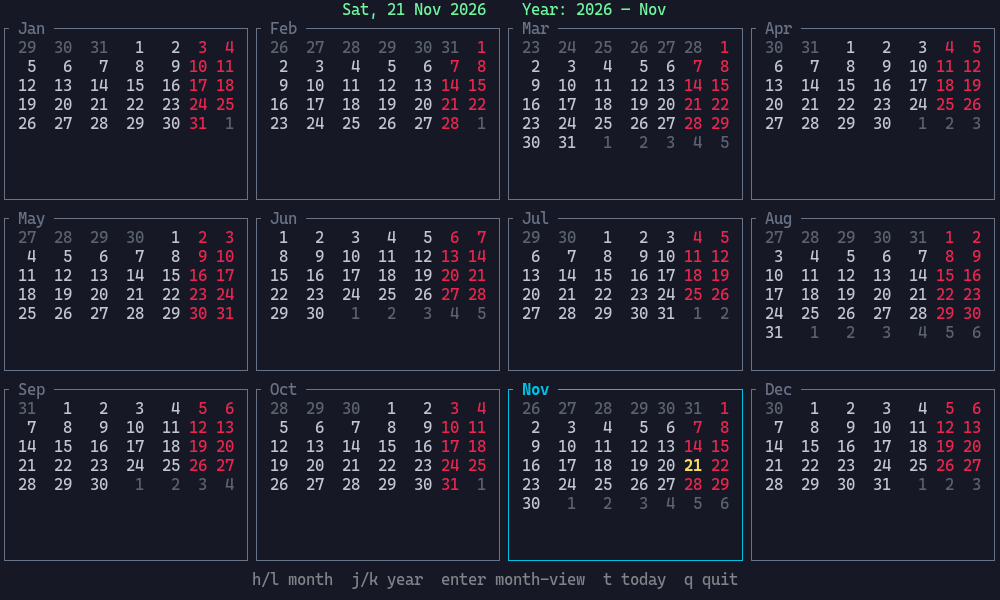

# Sweet-calendar-tui

Sweet theme for [calendar-tui](https://github.com/Gigas002/calendar-tui)

## Requirements

There's none, it's a color scheme

## Installation

Copy theme file to `~/.config/calendar-tui/themes/Sweet.toml`

Then, set it in `~/.config/calendar-tui/config.toml` (see [example](example/config.toml)):

```toml
[calendar]
theme = "Sweet.toml"
```

The background is transparent (alpha `00`), so it shows your terminal's Sweet background

## Showcase


