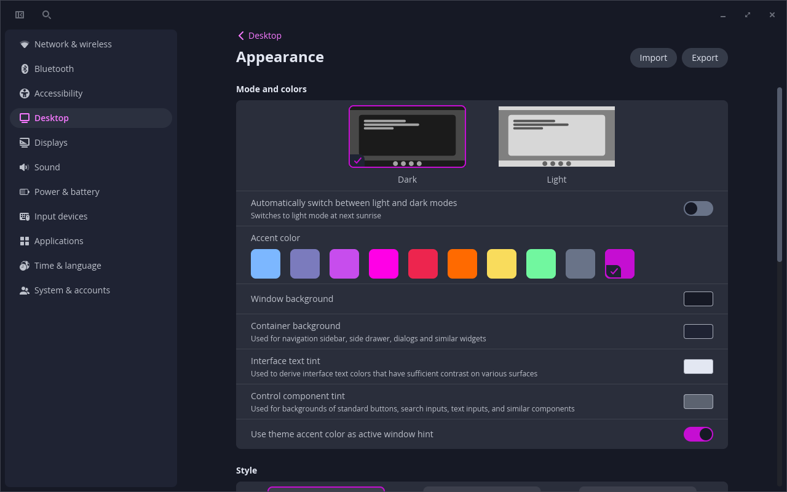

# Sweet-cosmic

Sweet theme for the [COSMIC](https://system76.com/cosmic) desktop

- navy surfaces: window `#161925`, containers `#1f2333` and `#282c34`
- accent `#c50ed2`, window hint `#c74ded`
- success `#71f79f`, warning `#f9dc5c`, destructive `#ed254e`
- the accent picker offers Sweet's colors

COSMIC themes all of its own apps and the panel. GTK and Qt apps need their own themes: [Sweet-gtk](https://github.com/Gigas002/Sweet-gtk), and [qt6ct](../qt6ct)

## Requirements

- COSMIC whose Appearance settings have `Import` (theme format `v2`; tested with cosmic-settings from Arch, 2026-11)

**Optional**

- Candy icons ([aur](https://aur.archlinux.org/packages/candy-icons-git)), or Sweet-Rainbow icons
- Sweet-cursors

## Installation

Open `Settings` → `Desktop` → `Appearance`, press `Import` and choose `Sweet.ron`. Or from a terminal:

```sh
cosmic-settings appearance import Sweet.ron
```

It's a dark theme, so keep `Dark` mode on

## Showcase


