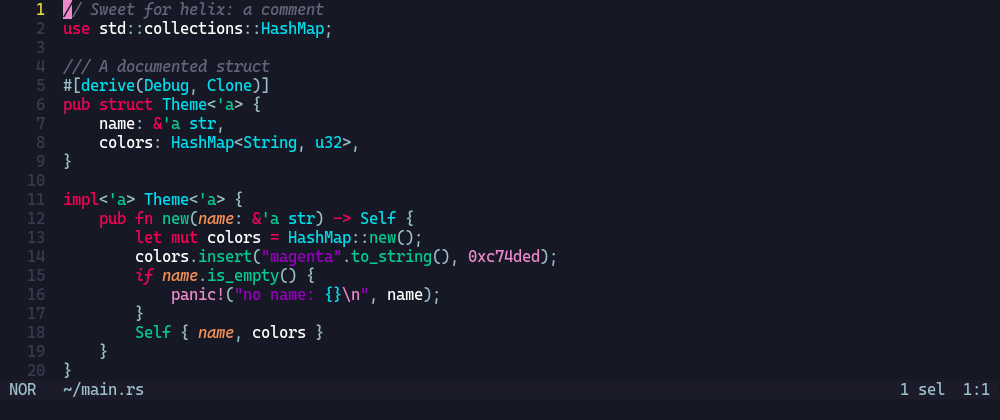

# Sweet-Helix

Sweet theme for [helix](https://github.com/helix-editor/helix) editor

The colors are the official [Sweet VS Code theme](https://github.com/EliverLara/sweet-vscode)'s, mapped onto helix's scopes. The background is left to the terminal (`ui.background = {}`), so it shows your terminal's Sweet background and transparency

## Requirements

There's none, it's a color scheme

## Installation

Copy the `Sweet.toml` file into `~/.config/helix/themes/Sweet.toml`. Then, add the theme into `~/.config/helix/config.toml`:

```toml
theme = "Sweet"
```

For the status line to change color with the mode, also set:

```toml
[editor]
color-modes = true
```

## Showcase


