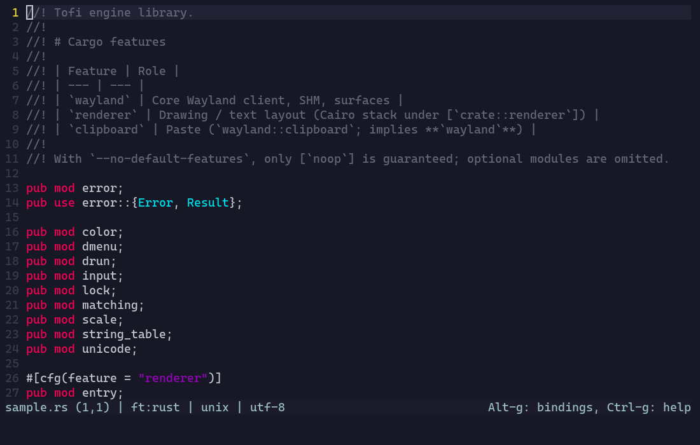

# Sweet-micro

Sweet theme for [micro](https://github.com/zyedidia/micro), with the syntax colors of [sweet-vscode](https://github.com/EliverLara/sweet-vscode)

The background is left to the terminal, so a transparent terminal stays transparent

## Requirements

- a truecolor terminal (`COLORTERM=truecolor`)

## Installation

Copy the `Sweet.micro` file into `~/.config/micro/colorschemes/Sweet.micro`. Then, add the theme into `~/.config/micro/settings.json`:

```json
{
    "colorscheme": "Sweet"
}
```

## Showcase


