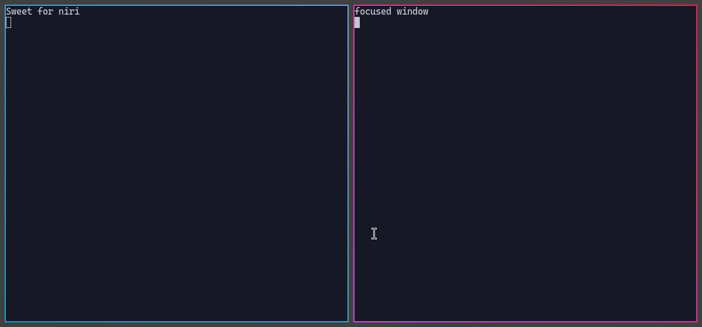

# Sweet-niri

Sweet theme for [niri](https://github.com/YaLTeR/niri) scrollable-tiling Wayland compositor

Gradient window borders: purple to red on the focused window, cyan to blue on the others, red for urgent ones

If you want a more unified look of your apps, also use the Sweet GTK theme, Sweet cursors and Kvantum or [qt6ct](../qt6ct) for Qt apps

## Requirements

There's none, it's a color scheme

## Installation

Copy theme file to `~/.config/niri/themes/Sweet.kdl`

Then, include it in `~/.config/niri/config.kdl`:

```kdl
include "themes/Sweet.kdl"
```

## Showcase


