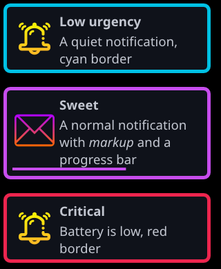

# Sweet-poshanka

Sweet theme for [poshanka](https://github.com/Gigas002/poshanka) notifications (with the [notred](https://github.com/Gigas002/notred) daemon)

The border tells the urgency: purple for normal, cyan for low, red for critical

## Requirements

**Optional**

- `NotoSans Nerd Font`, Sweet's default font
- Candy icons ([aur](https://aur.archlinux.org/packages/candy-icons-git))

## Installation

Copy `Sweet.toml` to `~/.config/poshanka/theme.toml`, and the `urgency` directory to `~/.config/poshanka/urgency`

Then, point `~/.config/poshanka/config.toml` at them:

```toml
[paths]
theme = "theme.toml"
overrides = [
    "urgency/low/config.toml",
    "urgency/critical/config.toml",
]
```

Run `notredctl reload` to apply the theme without restarting

## Showcase


