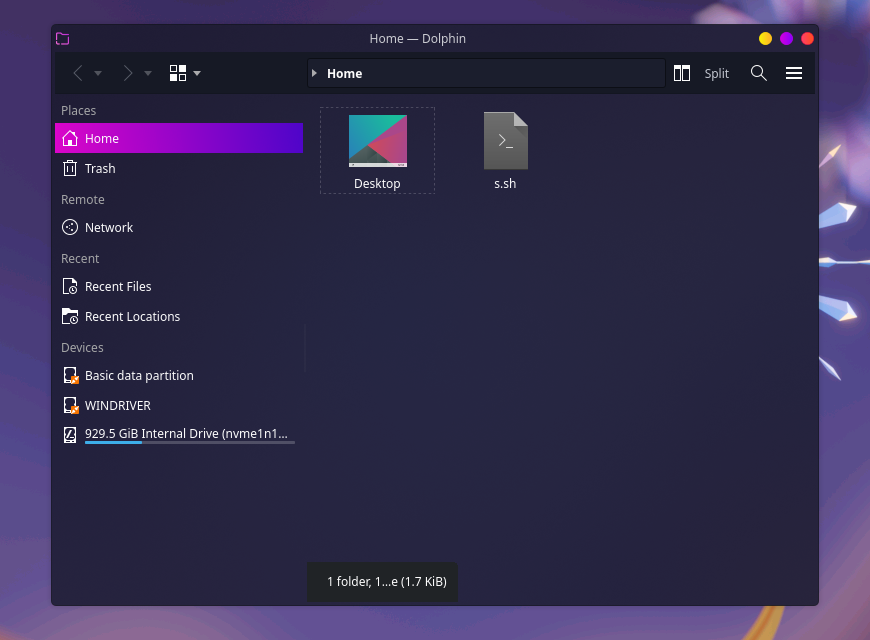

# Sweet-qt6ct

Sweet color scheme for [qt6ct](https://www.opencode.net/trialuser/qt6ct), the Qt 6 configuration tool for desktops other than KDE Plasma (niri, sway, hyprland, ...)

The colors are the palette KDE Plasma builds from [Sweet-kde](https://github.com/Gigas002/Sweet-kde)'s `Sweet.colors`, so Qt apps look the same in Plasma and outside of it. The only difference is `BrightText`: Plasma derives a dark grey `#4b4b4b`, which is unreadable on Sweet's navy, so here it's white

It's a palette only, so pair it with a widget style, e.g. `Fusion`, or `kvantum-dark` with the [Sweet Kvantum](https://github.com/Gigas002/Sweet-kvantum) theme

## Requirements

- `qt6ct` or `qt6ct-kde`

**Optional**

- Sweet kvantum theme
- Candy icons ([aur](https://aur.archlinux.org/packages/candy-icons-git)), or Sweet-Rainbow icons

## Installation

Copy theme file to qt6ct's colors directory: `~/.config/qt6ct/colors/Sweet.conf`

Make Qt apps use qt6ct, e.g. in `~/.config/environment.d/*.conf` or your compositor's environment: `QT_QPA_PLATFORMTHEME=qt6ct`

Then open `qt6ct`, and in `Appearance` choose `Palette: Custom`, color scheme `Sweet`. Or set it in `~/.config/qt6ct/qt6ct.conf`:

```ini
[Appearance]
custom_palette=true
color_scheme_path=/home/<user>/.config/qt6ct/colors/Sweet.conf
```

**Don't use qt6ct in a Plasma session.** Plasma's own platform theme (`kde`) must handle Qt apps there, or they ignore Plasma's color scheme and you can get dark text on dark background. If you set `QT_QPA_PLATFORMTHEME=qt6ct` globally (e.g. in `environment.d`), override it for Plasma in `~/.config/plasma-workspace/env/qt-platformtheme.sh`:

```sh
export QT_QPA_PLATFORMTHEME=kde
```

## Showcase


