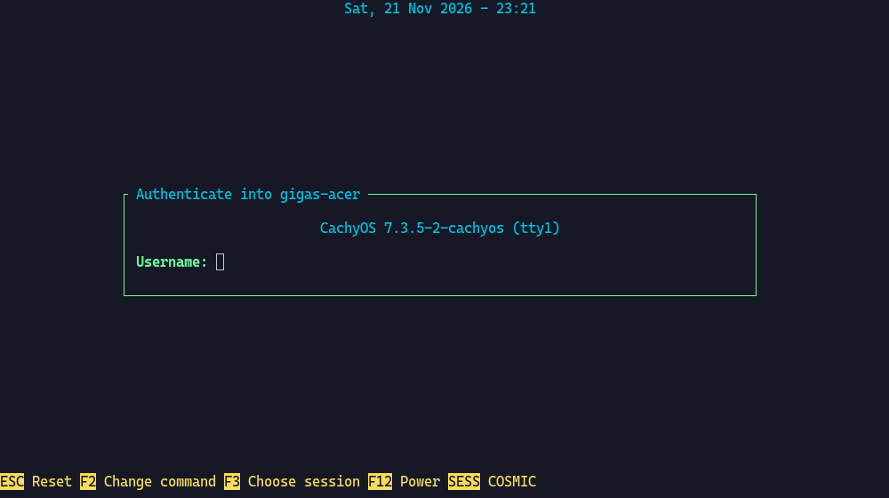

# Sweet-ratgreet

Sweet theme for [ratgreet](https://github.com/Gigas002/ratgreet), a TUI greeter for [greetd](https://sr.ht/~kennylevinsen/greetd/)

## Requirements

- A truecolor terminal for the greeter, e.g. greetd running ratgreet inside `cage` + a terminal, or `kmscon`. A plain Linux VT only has 16 colors and can't show hex colors

## Installation

Copy the `[colors]` table of `Sweet.toml` into `/etc/ratgreet/theme.toml` (system-wide) or `~/.config/ratgreet/theme.toml`

Or pass it once: `ratgreet --theme /path/to/Sweet.toml`

## Showcase

