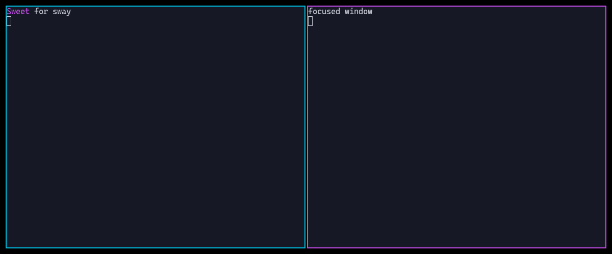

# Sweet-sway

Sweet theme for [sway](https://github.com/swaywm/sway)

Purple borders on the focused window, cyan on the others, red for urgent ones, with `NotoSans Nerd Font` titles

If you want a more unified look of your apps, also use the Sweet GTK theme, Sweet cursors and Kvantum or [qt6ct](../qt6ct) for Qt apps

## Requirements

**Optional**

- `NotoSans Nerd Font`, Sweet's default font
- Sweet cursors

## Installation

Copy theme file to `~/.config/sway/themes/Sweet`

Then, include it in `~/.config/sway/config`:

```
include ~/.config/sway/themes/Sweet
```

## Showcase


