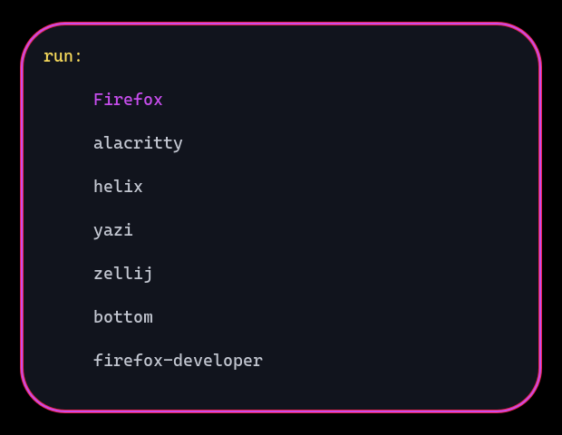

# Sweet-tofi-rs

Sweet theme for [tofi-rs](https://github.com/Gigas002/tofi-rs), a Rust rewrite of the tofi launcher with TOML configs. For the original tofi, see [tofi](../tofi)

## Requirements

**Optional**

- `CaskaydiaCove Nerd Font Mono`, Sweet's default monospace font

## Installation

Copy theme file to tofi's themes directory: `~/.config/tofi/themes/Sweet.toml`

Then, set it in `~/.config/tofi/config.toml` (see [example](example/config.toml)):

```toml
[base]
theme = "Sweet.toml"
```

Or pass it once: `tofi --theme ~/.config/tofi/themes/Sweet.toml`

## Showcase


