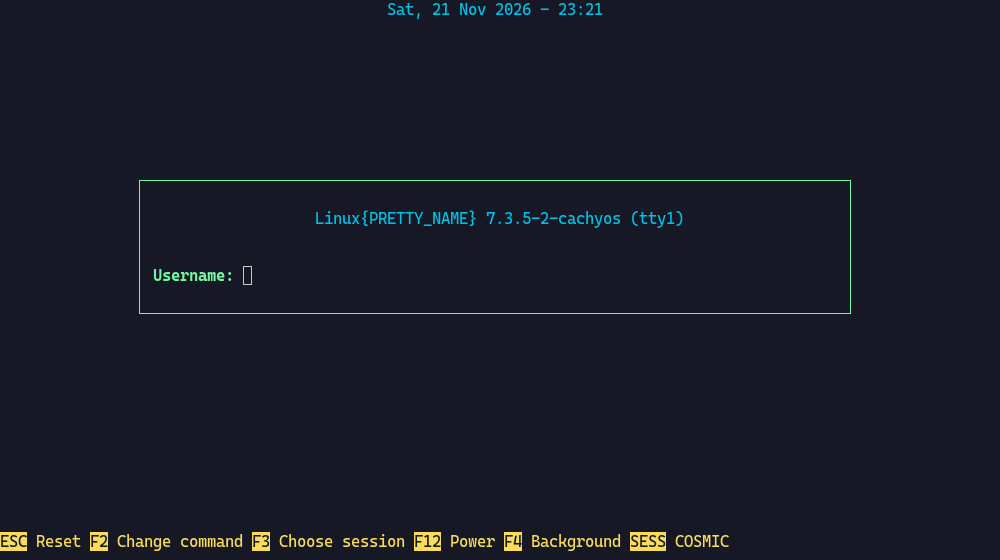

# Sweet-tuigreet

Sweet theme for [tuigreet](https://github.com/tuigreet/tuigreet), a TUI greeter for [greetd](https://sr.ht/~kennylevinsen/greetd/)

## Requirements

- tuigreet 0.11 or newer, which reads its settings from a TOML file
- A truecolor terminal for the greeter, e.g. greetd running tuigreet inside `cage` + a terminal, or `kmscon`. A plain Linux VT only has 16 colors and can't show hex colors

## Installation

Add the `[theme]` section of `Sweet.toml` to `/etc/tuigreet/config.toml` (or `~/.config/tuigreet/config.toml` of the greeter user), and run plain `tuigreet` from greetd's `/etc/greetd/config.toml`. See the [example](example/config.toml). `tuigreet --dump-config` shows the settings it ended up with; it ignores unknown keys without a word.

## Showcase

